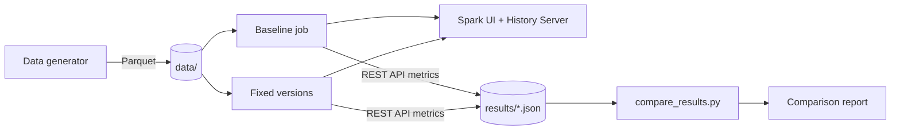

# Spark Performance Lab

A lab where I reproduce common Spark performance problems on a real multi-executor cluster, diagnose them in the Spark UI, and compare fixes using the metrics Spark itself reports. No screenshots and no simulated numbers.

**Stack:** PySpark 4.0 · Spark standalone cluster · Spark UI · History Server · Spark REST API · Python · Bash

> Part of my portfolio at **[devanshi4.github.io](https://devanshi4.github.io)**

## Highlights

- **A real bottleneck, reproduced:** 30 million transactions where one merchant owns most of the rows, on a real multi-executor cluster.
- **Three fixes, compared fairly:** AQE skew join, salting, and aggregating before the join, all with the same data and settings.
- **Only Spark's own numbers:** metrics come from Spark's REST API, and every fix must return exactly the same answer.

---

## The problem

Most slow Spark jobs come down to a handful of causes: skewed keys, spilling to disk, the wrong partition count, the wrong join strategy. Reading about them is easy. Finding them in a real job means knowing which numbers in the Spark UI to look at and what they mean together. This lab builds each problem on purpose, investigates it, and measures each fix.

| # | Experiment | Status |
|---|---|---|
| 1 | Data skew | done |
| 2 | Memory spill | planned |
| 3 | Partition count | planned |
| 4 | Join strategy (sort-merge vs broadcast) | planned |
| 5 | Out-of-memory and task failures | planned |

## How it works



1. **Cluster.** Two workers with two cores each, running as separate JVMs on one machine. This gives real executors, real shuffle traffic between them, and real executor logs, unlike `local[*]`.
2. **Baseline.** Each experiment has a slow version written on purpose, run with `--hold` so the live UI stays open for investigation.
3. **Fixes.** Each fix runs on the same data with the same shuffle settings, so the only difference is the fix.
4. **Measure.** After every run, the runner saves Spark's own metrics from its REST API. A verify script checks every version returns the same answer, and a compare script writes a side-by-side report.

## Experiment 1: data skew

**Scenario.** A payments company joins 30 million card transactions to 1 million merchants for a daily revenue report by category and country. One merchant owns most of the transactions, so in a sort-merge join all of its rows hash to the same shuffle partition, and one task does most of the work while the rest finish early.

**Fixes compared**

- **Adaptive Query Execution (AQE) skew join.** Spark detects the oversized partition at runtime and splits it. No code changes needed, but it only splits partitions above 256 MB.
- **Salting.** The hot merchant's join key gets a salt from 0 to 63, spreading its rows over all partitions. Its one row in the merchants table is copied 64 times so every salted key still matches.
- **Aggregate before joining.** The report only needs sums and counts, so transactions are first reduced to one row per merchant per day. The join then handles a much smaller table and the skew disappears. Sum and count are carried through so the average is computed correctly at the end.

## Design decisions

- **A real cluster, not local mode.** Separate executor processes make shuffle, spill and executor logs show up the way they do in production.
- **Same shuffle settings everywhere.** Every version of an experiment uses 16 shuffle partitions, so partition count can't hide or create the problem being tested.
- **Correctness first.** Every fix must produce exactly the same output as the baseline before its speed counts.
- **Only reported metrics.** Results come from Spark's REST API, the same data the UI shows. Nothing is estimated.
- **Honest about noise.** On a 4-core laptop, run times vary 10–20% between runs, and removing skew doesn't always cut total run time. The report shows the task-level metrics that explain why.

## Run it locally

You need Java 17 or 21, Python 3.9–3.13, about 8 GB of RAM and 3 GB of free disk.

1. Check your environment and install PySpark into a virtual environment:

   ```bash
   ./scripts/check_env.sh
   ```

   ```bash
   ./scripts/setup.sh
   ```

2. Start the cluster. The master UI is at http://127.0.0.1:8080 and the History Server at http://127.0.0.1:18080.

   ```bash
   ./scripts/start_cluster.sh
   ```

3. Generate the data (about 800 MB), then run the baseline with the live UI held open on :4040:

   ```bash
   ./scripts/run.sh data_generation.generate_exp01_data
   ```

   ```bash
   ./scripts/run.sh spark_jobs.before.exp01_skewed_join --hold
   ```

4. Run the three fixes, check they match, and build the comparison report:

   ```bash
   ./scripts/run.sh spark_jobs.optimized.exp01_aqe_skew_join
   ```

   ```bash
   ./scripts/run.sh spark_jobs.optimized.exp01_salted_join
   ```

   ```bash
   ./scripts/run.sh spark_jobs.optimized.exp01_aggregate_before_join
   ```

   ```bash
   ./scripts/run.sh scripts.verify_exp01_outputs
   ```

   ```bash
   ./scripts/run.sh scripts.compare_results exp01_data_skew
   ```

5. Stop everything when done. Event logs stay in `spark-events/`.

   ```bash
   ./scripts/stop_cluster.sh
   ```

## Project structure

```
├── conf/                # cluster shape and ports (cluster.env), shared paths (settings.py)
├── data_generation/     # synthetic, deliberately skewed datasets
├── spark_jobs/
│   ├── common/          # SparkSession, REST API metrics collector, run wrapper
│   ├── before/          # baseline (slow) versions
│   └── optimized/       # fixed versions
├── scripts/             # setup, cluster start/stop, run, verify, compare
└── docs/                # how Spark executes a job, Spark UI guide, experiment write-ups
```

## Status and next steps

- Commit the experiment 1 comparison report with measured task-level results.
- Build experiments 2 to 5: memory spill, partition count, join strategy, and out-of-memory failures.

---

Built by **Devanshi Pandya** · [Portfolio](https://devanshi4.github.io) · [LinkedIn](https://www.linkedin.com/in/devanshi4/)
